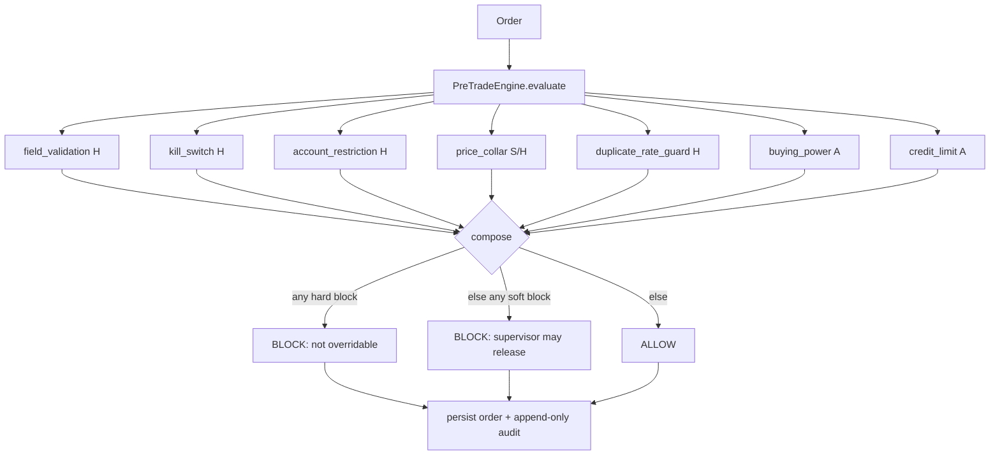

# Architecture

## The enforcement boundary

Every order, whether released from a proposal engine or entered manually, passes
through one evaluation point before it is persisted or routed. Concentrating the
decision in a single boundary is what makes the control set auditable and keeps
the rules from being duplicated across services and languages.

```
         order (domain.Order)
                |
                v
   +-------------------------+        reads
   |   PreTradeEngine        |  ----------------->  MarketDataProvider (quotes + freshness)
   |   (engine.py)           |  ----------------->  Store (accounts, prior orders, kill switch, config)
   |                         |
   |   runs control chain:   |
   |   field_validation   H  |
   |   kill_switch        H  |
   |   account_restriction H |
   |   price_collar      S/H |
   |   duplicate_guard    H  |
   |   buying_power       A  |
   |   credit_limit       A  |
   +-------------------------+
                |
                v
           Verdict (decision + per-control results)
                |
         +------+------+
         |             |
       persist      append-only
       order        audit trail
     (store.py)      (audit.py)
```

H = hard, S = soft, A = audit. `price_collar` is shown S/H because its severity
is decided per result: a price outside the band is soft (a supervisor may
release it), while a missing or stale quote escalates to hard, a data-integrity
failure that must not be waveable.

The same flow, as the scenario walkthrough narrates it:



## Composition rule

The engine composes the per-control results into one verdict:

- any **hard** control blocks  -> BLOCK, not overridable
- else any **soft** control blocks -> BLOCK, overridable by a supervisor
- else -> ALLOW

Audit-only controls are always recorded and never change the decision on their
own.

Composition is on the **per-result** kind, not the control's nominal
classification. This lets one control vary its severity by outcome: the price
collar is nominally soft, but it returns a hard result when the quote is missing
or stale, so a supervisor can release a price judgment but cannot wave an order
through while the market-data feed is down.

## Layers and why they are separated

- **domain** holds the value types. They are frozen dataclasses and enums, with
  `Decimal` for money and price. Nothing here imports storage or transport.
- **controls** each take an `Order` and an `EvaluationContext` and return one
  `ControlResult`. Because a control is a tiny pure-ish unit, each one has
  direct unit tests, including its fail-closed path.
- **engine** is pure with respect to its inputs: the same order and context
  produce the same verdict. That is what makes it benchmarkable and
  deterministic to test.
- **store** is the only module that knows SQL. The engine never sees a database
  row. The store could be swapped for Postgres without touching risk logic.
- **service** translates HTTP to domain types and back. It holds no risk logic.

## Request flow for an order

1. `service` parses the request and resolves the session (tenant, role, actor).
2. It builds a `domain.Order`; an unparseable request is turned into a
   field-validation block rather than a 500.
3. `engine.evaluate` runs the control chain against a fresh `EvaluationContext`
   (store, config, market data, a single `now` timestamp).
4. The order and its verdict are persisted, and a decision row is appended to
   the audit trail.
5. A supervisor may later override a soft block; the release and its reason are
   appended to the same append-only trail.

## Testing and performance

- `tests/test_engine.py` exercises the controls and the composition rule,
  including stale, missing, and future-dated quotes, the stale and unknown
  account read, the closing-only and restricted account cases, the duplicate
  window boundary, the soft-to-hard escalation, and the precedence of hard over
  soft.
- `tests/test_scenarios.py` asserts each narrated scenario produces the outcome
  it advertises, so the live demo and the suite cannot drift apart.
- `tests/test_service.py` drives the real HTTP handler on an ephemeral port:
  authentication, the order flow, and the supervisor override (including that an
  advisor cannot override and that a hard block is not overridable).
- `bench/latency.py` measures the per-order evaluation latency of the full chain
  against an in-memory store, isolating the engine from I/O.
- `mypy --strict` passes across the package, and CI runs the type check, the
  tests, and the scenario and benchmark smoke runs on Python 3.10, 3.11, 3.12.
